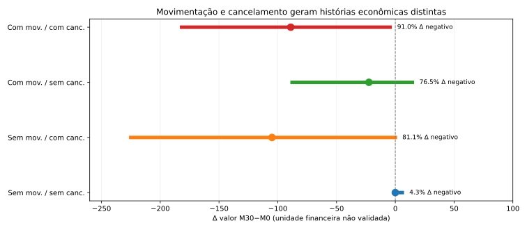
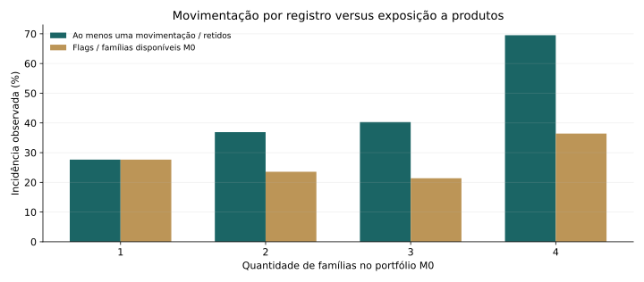
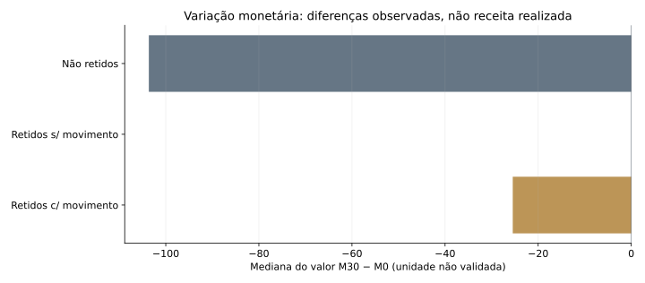

# Retenção e movimentação de produtos — estudo de perfis | Telecom, 2025

*Estudo de case com base sintética e anonimizada, referente a atendimentos de retenção de junho a dezembro de 2025. As associações descritas pertencem à amostra demonstrativa e não devem ser extrapoladas diretamente para uma operação real.*

> **Pergunta do case.** Quais características dos clientes classificados como **retidos** estão associadas à **movimentação de produtos** durante o atendimento, e o que isso sugere para melhorar a personalização das ofertas e proteger o valor pago?

## Principais descobertas

| Evidência | Resultado | Interpretação para a área de retenção |
|---|---:|---|
| Registros no período | **303.652** | Unidade: registro do funil; um cliente pode reaparecer |
| Status `RETIDO` | **249.309** | Desfecho do atendimento, não permanência futura |
| Retidos com alguma movimentação | **86.540 (34,7%)** | Medida central do estudo, condicionada à retenção |
| Retidos com movimento e redução de valor registrado | **78,7%** | A retenção pode coexistir com queda do valor observado |
| Primeiro registro retido por cliente (sensibilidade) | **34,8%** | Teste de sensibilidade à repetição de clientes, não nova definição de lead |
| Melhor modelo explicativo condicional no teste | **AUC 0,650** | Performance fora do treino de **P(movimento | retido, M0)** |

O estudo identifica associações entre movimentação, composição inicial da carteira, características do atendimento e mudanças de valor registrado. A comparação temporal dos modelos mostra capacidade discriminatória moderada e heterogênea entre as famílias de produtos. Aceite de oferta, faturamento incremental e efeitos causais não são variáveis identificáveis nesta base.

## Retenção e cancelamento de produtos — quatro situações distintas

A análise dos eventos contratuais identificou que **32.318** registros retidos **sem flag de movimentação** tiveram **cancelamento de produto**, com mediana M30−M0 de **−104,90**. Entre os retidos com movimentação, **13.161 (15,2%)** também cancelaram algum produto, com mediana **−88,96**. Os 130.451 retidos sem nenhum desses eventos tiveram mediana zero. Esses grupos não devem ser combinados ao avaliar mudanças de valor.

A diferença descritiva de movimentação entre SOLAR e LEGADO, entre retidos, caiu de **3,41 para 2,93 pontos percentuais** após padronização por mês e número de famílias em M0 (IC bootstrap agrupado por cliente: **2,53–3,41 p.p.**). Isso **não** identifica efeito causal de canal. Leads em aberto também geram intervalos muito diferentes para o status de retenção, especialmente em LEGADO.

**[Examine a análise de eventos contratuais](docs/deep_exploration_findings.md)** e o [notebook com gráficos e cenários econômicos](notebooks/07_exploratory_deep_dive.ipynb). Lucro, aceite de ofertas e sobrevivência posterior continuam variáveis não identificáveis com a fonte atual.

## Desbalanceamento e oportunidades por família

A contagem absoluta de alterações favorece produtos mais presentes no início do atendimento. Entre registros `RETIDO` com a família em M0, Banda Larga (internet fixa) teve **74.255 movimentações em 239.562 elegíveis (31,0%)**; Móvel teve **4.387 em 10.964 (40,0%)**. Logo, **o ranking de volumes não é o ranking de propensão condicional**. TV registrou 17,7% e Fone 11,3% entre elegíveis.

No teste cronológico por família, **os modelos ponderados sem recalibração posterior tiveram Brier pior nas quatro comparações**. Isso não descarta a ponderação acompanhada de calibração. Em Fone, houve aumento de AUC (0,551→0,574), mas o Brier passou de 0,1061 para 0,2219. Em Móvel, a pequena vantagem de validação do modelo ponderado não se repetiu no teste. Portanto, a ponderação não deve ser aplicada por padrão. Os números e os denominadores estão na [análise específica](docs/family_imbalance_analysis.md).

A movimentação das quatro famílias foi examinada como **quatro resultados binários que podem ocorrer simultaneamente**, e não como classes mutuamente exclusivas. A [avaliação específica de desbalanceamento](docs/family_imbalance_analysis.md) apresenta os denominadores e testa a sensibilidade dos modelos à ponderação de classes, preservando a prevalência natural no teste. A avaliação de ofertas por produto requer taxas condicionadas à elegibilidade e medidas de desempenho específicas por família.

## 1. Movimentação entre registros retidos

Carteiras com mais famílias apresentam maior chance de *alguma* movimentação, mas também oferecem mais possibilidades de alteração. Ao comparar flags por família disponível em M0, a tendência muda. Por isso, o estudo utiliza **P(movimentação | RETIDO, características M0)** como questão principal. O modelo de evento composto é apenas uma análise secundária.

### Segmentação por composição inicial

| Mix M0 | Registros retidos | Com alguma movimentação |
|---|---:|---:|
| BL | 82.490 | 28,9% |
| BL+TV | 63.301 | 36,3% |
| BL+TV+FONE | 61.897 | 39,0% |
| BL+FONE | 21.380 | 35,0% |
| TV | 7.120 | 15,7% |
| BL+MV | 4.802 | 55,5% |
| BL+TV+MV | 2.511 | 64,8% |
| BL+TV+FONE+MV | 2.333 | 69,5% |
| TV+FONE | 1.169 | 21,1% |
| FONE | 858 | 8,2% |

As diferenças entre grupos são descritivas e podem refletir origem, elegibilidade, preço e regras de oferta.

### Canais e período

| Origem | Retidos | Movimentação entre retidos |
|---|---:|---:|
| LEGADO | 51.214 | 32,0% |
| SOLAR | 198.095 | 35,4% |

As proporções de atendimentos pendentes são muito diferentes entre canais; portanto **os contrastes entre origens são descritivos, não uma comparação de eficiência causal**.

## 2. Movimentação contratual e aceite de ofertas

A base não registra a oferta apresentada nem a decisão de aceite. A análise utiliza dois indicadores de movimentação contratual, sem tratá-los como taxa de aceite:

- **Proxy ampla de movimentação**: ao menos uma `FLAG_MOV_* = 1` (inclui mudanças que podem ser motivadas por outras razões).
- **Proxy restritiva, compatível com uma mudança contratual de oferta**: flag de movimentação, código/plano diferente em M30, produto presente em M30 e ausência de flag de cancelamento da família. Foram observados **86.540** registros com essa condição (**34,7%** entre retidos).

Nesta amostra, **os dois sinais coincidem exatamente (86.540 registros)**: a proxy restritiva não fornece qualquer informação adicional sobre aceite. **Nenhum deles estima diretamente a taxa de aceite**; inclusive a proxy restritiva pode conter mudanças sem oferta ou deixar de fora ofertas de desconto sem troca de produto. Cenários com 25%, 50% ou 75% dos movimentos associados a aceites são simulações hipotéticas, não estimativas observadas.

## 3. Valor monetário: retenção não significa manutenção do valor

Nos retidos com movimentação, a mediana dos valores M30−M0 é **-25,46** e **78,7%** apresentam redução; no agregado, a soma dos valores registrou variação de **-20,1%**. Os valores representam montantes associados ao registro, sem detalhamento de competência, descontos ou consolidação de pacotes. As diferenças não identificam margem, faturamento reconhecido ou efeito causal de ofertas.

A decomposição de trocas, saídas, inclusões e alterações por família consta do [relatório de resultados](docs/study_report.md).

## 4. Modelagem da movimentação entre retidos

Todos os modelos receberam o **mesmo conjunto de teste cronológico de novembro–dezembro**, exclusivo de clientes usados no treino e na validação. Alvo: movimentação entre observações com status `RETIDO`. Esta modelagem é **explicativa e retrospectiva**, porque o status de retenção não é conhecido no instante inicial M0.

| Modelo | AUC-ROC | Average precision | Brier | Log-loss | Lift no decil superior |
|---|---:|---:|---:|---:|---:|
| prior | 0,500 | 0,330 | 0,2216 | 0,6352 | 1,00× |
| logistic | 0,627 | 0,458 | 0,2104 | 0,6099 | 1,68× |
| small tree | 0,629 | 0,444 | 0,2097 | 0,6083 | 1,67× |
| hist boosting | 0,650 | 0,487 | 0,2065 | 0,6010 | 1,81× |

O modelo **hist boosting** foi selecionado pelo Brier em outubro; os quatro foram avaliados no mesmo holdout. O relatório apresenta desempenho por mês, origem e bandas de calibração. Essas métricas caracterizam a previsão retrospectiva de movimentação; não estimam aceite nem efeito de oferta.

## 5. Implicações para a retenção

1. **Oferta relevante ao mix M0:** testar abordagens por família disponível, em vez de usar número bruto de movimentações como eficácia.
2. **Proteção do valor observado:** auditar mudanças de plano e valor negativo em retidos, por tipo de transição, antes de transformar desconto em meta financeira.
3. **Processo de atendimento e desfechos pendentes:** uniformizar o fechamento de leads antes de comparar `SOLAR` e `LEGADO`.
4. **Medição real de aceite e eficácia:** capturar oferta apresentada, elegibilidade, oferta aceita, incentivo e data; testar alternativas com controle randomizado e mensurar retenção posterior e receita reconhecida.

## Apresentação executiva

- [Apresentação — resultados e recomendações](presentations/Case_Retencao_Resultados_e_Descobertas_2025.pptx)

## Como consultar as evidências

- [Relatório completo: perguntas, perfis, inferências, matriz de decisões e limitações](docs/study_report.md)
- [Notebook 06 — perfis entre retidos, proxy de aceite e comparação condicional de modelos](notebooks/06_retained_profiles_and_offer_proxies.ipynb)
- [Notebooks 01–08 — auditoria, perfis, exploração, modelagem e desbalanceamento](notebooks/)
- [Metodologia e dicionário](docs/methodology.md) · [Referências científicas](docs/benchmark_and_gap_review.md)

