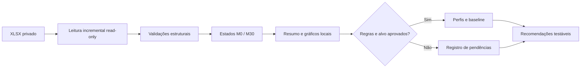

# Customer Retention Analytics

**Estudo de retenção e movimentação de produtos em telecomunicações — auditoria reproduzível, caracterização de perfis e decisões de negócio.**

> **Janela de análise:** 1º de junho a 31 de dezembro de 2025, inclusive. **Granularidade atual:** registro do funil, candidato a episódio de atendimento. **Governança:** a planilha original e saídas com dados reais são confidenciais e não são versionadas.

## O problema de negócio

A operação de retenção procura entender quais características dos clientes estão associadas à **retenção com movimentação de produtos** (Banda Larga, TV, Fone e Móvel). O projeto responde a essa pergunta sem confundir três fenômenos:

| Dimensão | Observação operacional possível | Limite do dado |
|---|---|---|
| Retenção | Status final do lead, provisoriamente `RETIDO` | Não comprova permanência futura do cliente |
| Movimentação | Flags por família e transições dos produtos entre M0 e M30 | Não comprova aceite de oferta ou aumento de receita |
| Preservação de receita | Diferenças observadas em campos monetários `VALOR_*_M0/M30` | Sem comprovação de valor faturado, periodicidade ou margem |

O projeto é deliberadamente **evidence-first**: nenhuma inferência causal será tirada de comparações observacionais; modelos preditivos somente serão construídos após a validação da unidade de análise, do alvo e da disponibilidade temporal das variáveis.

## Estado real das entregas

| Frente | Entrega | Estado |
|---|---|---|
| Fundamentação | Escopo, critérios, dicionário preliminar, limitações e decisões | Documentada; regras de negócio **pendentes** |
| Qualidade de dados | Auditoria incremental da planilha e testes sintéticos | Código e notebook implementados; saídas reais **somente locais** |
| Perfis e modelagem | Exploração, características, baseline e validação temporal | **Ainda não implementados**; dependem da validação do alvo |
| Inteligência de negócio | Recomendações e apresentação executiva | Depende da análise reprodutível e autorização de divulgação |
| Portfólio | Demonstração técnica pública | Somente dados sintéticos ou material expressamente autorizado |

**Entrega atual:** `notebooks/01_data_audit.ipynb` contém leitura de resumo gerado localmente, tabelas e visualizações, sem incorporar a planilha nem resultados confidenciais à versão Git. O processamento de dados ocorre em `src/`, separado da apresentação.

## Arquitetura



```text
customer-retention-analytics/
├── .github/workflows/ci.yml         # Testes com dados sintéticos, sem planilha
├── data/README.md                    # Política de dados; data/raw/ ignorada
├── docs/                             # Regras, auditoria, decisões e riscos
├── notebooks/01_data_audit.ipynb    # EDA auditável; outputs reais não versionados
├── src/retention_analytics/
│   ├── xlsx_stream.py                # Leitura da aba completa via ZIP/XML
│   ├── audit.py                      # Métricas e contratos de integridade
│   └── cli.py                        # Execução em linha de comando
├── tests/                            # Casos sintéticos independentes
├── pyproject.toml                    # Pacote Python e dependências
└── README.md
```

## Reproduzir a auditoria

**Pré-requisitos:** Python 3.11+, acesso autorizado à planilha e ambiente local com memória para ler o índice de strings do XLSX. Não é necessário banco de dados, nuvem ou API externa.

```bash
python -m venv .venv
# Linux/macOS: source .venv/bin/activate
# Windows PowerShell: .venv\Scripts\Activate.ps1
python -m pip install -e ".[dev,analysis]"
```

Armazene a planilha em `data/raw/retention_case.xlsx` **somente no ambiente autorizado**. O nome acima é local e não corresponde a um arquivo versionado.

```bash
retention-audit \
  --input data/raw/retention_case.xlsx \
  --output reports/private/audit_summary.json \
  --min-group-size 30
```

Esse comando percorre a aba completa, não o intervalo nomeado da pasta de trabalho, e grava **apenas no caminho local ignorado** contagens, medidas de qualidade e hash SHA-256 do arquivo de entrada. Para usar outra versão da fonte, **execute novamente** a auditoria; não reutilize resumos anteriores sem conferir a proveniência.

O notebook é executado da raiz do projeto, após gerar o JSON local:

```bash
jupyter lab notebooks/01_data_audit.ipynb
```

O notebook lê o resumo privado, verifica os denominadores e exibe gráficos por mês e informações de integridade. **Não carrega nem exibe identificadores individuais de clientes.** A versão versionada possui células sem resultados executados; notebooks com saídas reais devem permanecer fora do Git.

### Testes e CI

```bash
python -m pytest -q
python -m compileall -q src tests
ruff check src tests
```

O workflow em `.github/workflows/ci.yml` foi projetado exclusivamente para instalar dependências, validar o código e executar testes com linhas sintéticas. Nunca vincule a planilha ao GitHub Actions, mesmo no repositório privado.

## Principais decisões metodológicas

1. **Granularidade:** `id_cliente` se repete, portanto a análise não elimina registros repetidos por padrão. A chave oficial de episódio/lead continua pendente.
2. **População:** somente entradas de junho a dezembro de 2025. `LEAD EM ABERTO` é observado separadamente, sem ser imputado como não retenção.
3. **Status:** `RETIDO` é um desfecho operacional provisório do funil, não medida de sobrevivência do relacionamento.
4. **Movimentação:** `FLAG_MOV_*` e mudança de código de produto são auditadas separadamente; mudança de preço não implica movimentação.
5. **Receita:** os campos monetários são descritos, sem inferir receita contábil, ganho incremental, margem ou desconto efetivamente realizado.
6. **Modelagem:** variáveis M30 e flags/desfechos posteriores não podem entrar como atributos de uma predição feita em M0. Segmentação descritiva e baseline interpretável precedem modelos complexos.
7. **Sobrevivência:** Kaplan–Meier e Cox só serão considerados quando datas de evento, duração e censura forem demonstradas.

**Documentação técnica:** [`project_charter.md`](docs/project_charter.md), [`methodology.md`](docs/methodology.md), [`data_audit_protocol.md`](docs/data_audit_protocol.md), [`data_dictionary.md`](docs/data_dictionary.md), [`decision_log.md`](docs/decision_log.md), [`limitations.md`](docs/limitations.md).

## Segurança, confidencialidade e limites

- O repositório privado contém somente código, documentação e testes sintéticos. Dados `.xlsx`, exportações `.csv`, modelos, relatórios detalhados, fingerprints e outputs reais ficam nos diretórios ignorados pelo Git.
- Uma mudança de visibilidade, publicação de agregados ou portfólio público depende de **aprovação específica do titular dos dados** e revisão do risco de reidentificação, inclusive para grupos pequenos. O limiar técnico padrão de supressão é `n < 30` para as segmentações exportadas da auditoria, sujeito à política oficial.
- Frequências da amostra não são taxas corporativas nem evidência de impacto causal de ofertas.
- A licença `LICENSE` atualmente presente é Unlicense; sua presença **não libera direitos sobre informações de terceiros**, nem autoriza divulgar dados e resultados comerciais.

## Benchmarking e revisão de profundidade

A revisão de literatura, repositórios externos e lacunas científicas está em [`benchmark_and_gap_review.md`](docs/benchmark_and_gap_review.md). O [checklist de critérios de aceite](docs/study_acceptance_gates.md) evita confundir CI aprovado com estudo concluído.

O módulo [`deep_diagnostics.py`](src/retention_analytics/deep_diagnostics.py) testa a interpretação da movimentação por registro e por família de produto disponível em M0, comparando exposição entre carteiras. Resultados efetivos devem ser calculados **localmente**; não implicam causalidade.

## Referências metodológicas

Os repositórios [`AnaliseSobrevivencia`](https://github.com/renatomenendes/AnaliseSobrevivencia), [`framework_pinhao`](https://github.com/renatomenendes/framework_pinhao), [`Analytics-Engineering-Blueprint`](https://github.com/renatomenendes/Analytics-Engineering-Blueprint) e [`pbi-profiling`](https://github.com/renatomenendes/pbi-profiling) foram considerados como **referências conceituais**, não como fontes de dados, código importado ou resultados deste case. Critérios e ressalvas estão em [`repository_reuse_assessment.md`](docs/repository_reuse_assessment.md).

---

**Status de rigor:** auditoria implementada e suas métricas sujeitas às definições de negócio. A validação formal da população, dos eventos e da unidade monetária é pré-condição para conclusões financeiras, preditivas e executivas.
