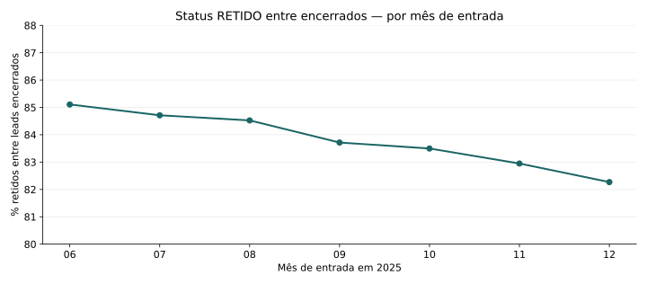

# Perfis de retenção com movimentação de produtos | Telecomunicações

**Estudo observacional · junho–dezembro de 2025 · base de clientes sob confidencialidade**

> **Questão central.** Quais perfis caracterizam registros de clientes classificados como **retidos com movimentação de produtos**? O que suas transições entre M0 e M30 permitem — e não permitem — concluir sobre a preservação de valor?

Este repositório apresenta **perguntas de negócio, evidências, métodos, interpretações e recomendações**. Os notebooks permitem examinar os cálculos. O código utilizado na reprodução está disponível, mas não constitui o objeto principal da apresentação.

## Síntese das descobertas

| Evidência observada | Resultado na amostra | Leitura relevante |
|---|---:|---|
| Registros na janela | **303.652** | Unidade observada: registro do funil, não cliente único comprovado |
| Classificados como retidos | **249.309** | Status de atendimento, não permanência sustentada |
| Retidos com alguma movimentação | **86.540** | **34,7%** dos registros retidos |
| Registros com desfecho em aberto | **6.252** | Não devem ser imputados como perda |
| Mediana M30 − M0 no grupo retido com movimento | **−25,46** | Unidade dos campos **VALOR_*** ainda não validada; não é perda faturada |
| Modelo experimental no teste temporal | **AUC 0,662; Brier 0,1849** | Alvo composto distinto do perfil condicionado aos retidos |

### Descoberta 1 — Mais produtos não equivalem, necessariamente, a maior propensão por produto

A incidência de **qualquer movimentação entre retidos** foi de **27,6%** nas carteiras com uma família, **36,9%** com duas, **40,3%** com três e **69,5%** com quatro. Contudo, quando o denominador passa a ser o **total de famílias presentes em M0**, as incidências observadas de flags foram **27,6%**, **23,6%**, **21,4%** e **36,4%**, respectivamente.

**Interpretação:** comparar somente “alguma movimentação” favorece carteiras com mais oportunidades de alteração. A normalização por família não elimina confundimento, mas muda a leitura do perfil. Não há evidência causal de que ampliar a carteira provoque movimentação.

### Descoberta 2 — A participação de retenções encerradas muda ao longo da janela

A proporção do status `RETIDO` entre os leads **encerrados** passou de **85,1% em junho para 82,3% em dezembro**. O volume mensal ficou próximo de 43 mil registros, e a proporção de casos em aberto varia por mês e origem. **Não é adequado interpretar essa diferença como queda causal da eficácia comercial:** o desenho amostral e a maturidade do funil ainda não foram validados.

### Descoberta 3 — Retenção com mudança de produtos não implica preservação dos valores observados

Nos **86.540 registros retidos com movimentação**, **78,7%** apresentaram diferença negativa dos valores M30–M0; a mediana foi **−25,46**, e a soma dos campos monetários desse grupo variou **−20,1%** entre os estados observados. Para retidos sem movimentação, a mediana foi **zero**. Os campos não possuem unidade, competência financeira, descontos e regras de bundle formalmente validados; assim, **não são demonstração de receita, margem ou perda incremental**.

### Descoberta 4 — Há sinal preditivo, mas não evidência de uplift comercial

O experimento com atributos iniciais e teste em **novembro–dezembro de 2025** atingiu **AUC-ROC 0,662**, **average precision 0,405**, **Brier 0,1849** e **lift de 1,84× no decil superior**. A baseline constante obteve Brier 0,1988. O alvo foi a ocorrência conjunta de **`RETIDO` e movimentação entre leads encerrados**. Não mede, isoladamente, a movimentação *entre retidos*, nem o efeito de uma oferta. A regressão logística foi avaliada apenas na validação; não está demonstrado que a árvore seja superior fora da amostra.

## Como o problema foi definido

| Dimensão | Definição operacional provisória | Fronteira de interpretação |
|---|---|---|
| Retenção | `NM_SUB_INDICADOR_NEGOCIO = RETIDO`, apenas no funil | Sem confirmação de atividade posterior ou contrato ativo |
| Movimentação | Pelo menos uma `FLAG_MOV_* = 1`, confrontada com produto M0/M30 | Não se conhece aceite da oferta nem mudança de volume recorrente |
| Valor | Σ dos campos `VALOR_*_M30` − Σ `VALOR_*_M0` | Snapshot de valores, sem comprovação de receita realizada |

**Universo analisado:** registros com entrada entre 01/06 e 31/12/2025, inclusive; excluídos dois fora da janela. `id_cliente` reaparece em múltiplas linhas: sem chave oficial do atendimento, as taxas são por **registro**, não por cliente único. Casos `LEAD EM ABERTO` são apresentados à parte.

## Perguntas respondidas e próximas decisões

| Pergunta de negócio | O que os dados sustentam | Ação testável sugerida |
|---|---|---|
| Qual carteira concentra alterações? | Evidência por mix e por oportunidade M0 | Testar jornadas por família disponível, mantendo comparabilidade |
| O canal importa? | Diferenças descritivas entre `SOLAR` e `LEGADO` | Reconciliar desfechos pendentes e composição antes de comparação de eficiência |
| Retenção protege valores? | Diferenças negativas M0–M30 observadas entre retidos que movimentaram | Auditar preço, descontos e cancelamento parcial e mensurar receita real |
| Um score ajuda? | Discriminação experimental do evento composto, em split temporal | Validação prospectiva, calibração, estabilidade e teste controlado de oferta |

A priorização, responsáveis, critérios de teste e evidências encontram-se no [relatório do estudo](docs/study_report.md). **Não há retorno financeiro incremental demonstrado.**

## Percurso de leitura do estudo

1. **[Relatório científico e executivo](docs/study_report.md):** objetivos, universo, diagnóstico, perfis, sinais, economia, implicações e limitações.
2. **[Síntese analítica reproduzível](notebooks/05_study_synthesis.ipynb):** cálculos e visualizações dos agregados observados, sem exposição de linhas individuais.
3. **[Apresentação executiva](presentations/executive_study.md):** narrativa para discussão de decisões e experimentos.
4. [Auditoria e integridade](notebooks/01_data_audit.ipynb), [perfis e valores](notebooks/02_profiles_and_economics.ipynb), [predição temporal](notebooks/03_temporal_model_validation.ipynb) e [decisões](notebooks/04_business_decisions.ipynb): notebooks aprofundados, que requerem os agregados privados produzidos localmente.
5. [Metodologia](docs/methodology.md), [dicionário](docs/data_dictionary.md), [limitações](docs/limitations.md) e [referências científicas](docs/benchmark_and_gap_review.md): fundamento para auditabilidade.

## Reprodutibilidade e confidencialidade

Os gráficos e a síntese utilizam o conjunto **[agregado, com grupos grandes](reports/aggregate_study_2025.json)**, derivado das execuções locais dos notebooks de auditoria, perfis e modelo. Não contém dados de clientes, identificadores ou fingerprints da planilha. Os arquivos brutos e as saídas privadas permanecem fora do Git.

Para recomputar os resultados com a planilha original em ambiente autorizado: Python 3.11+, `python -m pip install -e ".[analysis,dev]"`, seguido de `retention-audit --input data/raw/retention_case.xlsx --output reports/private/audit_summary.json` e `retention-analyze --input data/raw/retention_case.xlsx --out-dir reports/private`. Para revisitar **a síntese publicada** sem dados brutos, execute `notebooks/05_study_synthesis.ipynb` com o arquivo agregado versionado.

A classificação dos resultados neste repositório é **observacional e provisória**. Sua reprodução algorítmica não valida semânticas de negócio: estão pendentes a chave do episódio, significado financeiro dos campos, definição do evento de retenção sustentada, universo amostral e desenho experimental. A política de divulgação deve ser revista antes de qualquer alteração da visibilidade privada.

## Base conceitual e literatura

- Verbeke et al. (2012), [avaliação de churn orientada ao lucro](https://doi.org/10.1016/j.ejor.2011.09.031): decisões exigem custos e resultados financeiros, não apenas AUC.
- Verhelst et al. (2025), [benchmark de uplift em telecom](https://doi.org/10.1007/978-3-031-74640-6_21): propensão e efeito incremental são problemas diferentes.
- [scikit-learn: calibração de probabilidades](https://scikit-learn.org/stable/modules/calibration.html): Brier não dispensa curvas de confiabilidade.

**Conclusão:** os dados sustentam perfis descritivos relevantes e mostram tensões entre movimentação e valor observado; **a decisão ótima de retenção e sua receita incremental ainda não estão identificadas**.