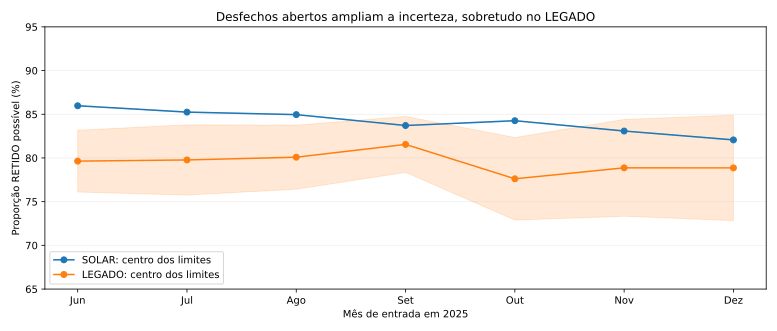
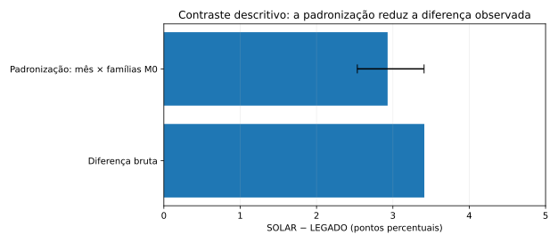

# Exploração aprofundada — o que movimentação e retenção realmente representam

**Pesquisa:** telecomunicações, leads com entrada entre junho e dezembro de 2025. **Fonte:** planilha do case processada localmente, arquivo de agregados `reports/extended_eda_2025.json`. **Unidade:** registro da planilha; não equiparar a cliente único ou episódio oficial. **Classificação:** resultados observacionais restritos ao repositório privado. Os números são calculados, mas as definições comerciais permanecem provisórias.

## Resumo científico

A análise anterior contrastava movimentação versus ausência de movimentação entre os 249.309 registros classificados como retidos. **Essa divisão escondia cancelamentos de produtos entre os que não se movimentaram**. A decomposição em quatro situações revela que **32.318 retidos sem flag de movimentação tiveram cancelamento de pelo menos um produto**, com mediana de mudança de valor de **−104,90**, e **81,1%** de valores negativos. A categoria não constitui necessariamente sucesso comercial integral.

Entre os **86.540 retidos com movimentação**, **13.161 (15,2%)** também registraram cancelamento parcial. A mediana de M30−M0 desse subgrupo foi **−88,96**, comparada a **−22,48** para 73.379 retidos com movimento sem cancelamento. Todas são diferenças dos campos de valores fornecidos; não mensuram perda de faturamento atribuível à ação.

O contraste bruto de movimentação entre retidos **SOLAR menos LEGADO** foi **+3,41 p.p.**. Padronizando a distribuição por mês e quantidade de famílias em M0, ficou em **+2,93 p.p.**, com intervalo bootstrap Poisson agrupado por cliente de **[+2,53; +3,41] p.p.**, a partir de 200 réplicas. Isso melhora a comparação *descritiva*, sem identificar efeito causal do canal: só controla dois fatores e é condicionado à retenção já observada.

## 1. A dimensão oculta: cancelamento e movimentação são eventos distintos

| Retidos: evento composto | Registros | Mediana ΔV | ΔV negativo | P10 ΔV | P90 ΔV |
|---|---:|---:|---:|---:|---:|
| Sem mov. / sem canc. | 130,451 | 0,00 | 4.3% | 0,00 | 5,93 |
| Sem mov. / com canc. | 32,318 | -104,90 | 81.1% | -225,07 | 0,00 |
| Com mov. / sem canc. | 73,379 | -22,48 | 76.5% | -87,82 | 14,52 |
| Com mov. / com canc. | 13,161 | -88,96 | 91.0% | -181,80 | -4,40 |

**Implicação:** agrupar todos os casos `RETIDO` como contratos economicamente preservados é incorreto. Os cancelamentos parciais exigem uma trilha analítica própria; flag de movimentação sinaliza troca/substituição de plano, enquanto cancelamento foi codificado separadamente na base.

O grupo sem movimento e sem cancelamento registra mediana zero e 84% de deltas exatamente nulos — comportamento distinto dos demais. Mesmo assim não comprova retenção posterior ao funil.

## 2. O que mudou nos quatro produtos — estados M0 e M30

| Família | Transição de código | Registros | FLAG_MOV | FLAG_CANC | Δ médio entre pares numéricos | Pares com Δ negativo |
|---|---|---:|---:|---:|---:|---:|
| BL | replacement | 74,255 | 74,255 | 0 | -22,08 | 80.0% |
| BL | removal | 22,478 | 0 | 22,478 | -101,32 | 96.3% |
| BL | unchanged | 142,829 | 0 | 0 | 0,98 | 1.2% |
| TV | replacement | 24,595 | 24,595 | 0 | -30,76 | 74.4% |
| TV | removal | 19,381 | 0 | 19,381 | -118,33 | 97.8% |
| TV | unchanged | 94,778 | 0 | 0 | 1,46 | 8.0% |
| FONE | replacement | 10,007 | 10,007 | 0 | 0,00 | 0.0% |
| FONE | removal | 17,059 | 0 | 17,059 | 0,00 | 0.0% |
| FONE | unchanged | 61,512 | 0 | 0 | 0,00 | 0.0% |
| MV | replacement | 4,387 | 4,387 | 0 | -4,81 | 53.9% |
| MV | unchanged | 6,577 | 0 | 0 | -1,64 | 4.3% |

A maior parte das flags de movimentação se associa à **substituição de código**: BL (74.255 trocas), TV (24.595), Fone (10.007) e Móvel (4.387). Já as **remoções** são capturadas em `FLAG_CANC_*`, sem `FLAG_MOV_*`, como mostram BL (22.478), TV (19.381) e Fone (17.059). Isso explica a categoria de cancelamento sem movimentação e é consistente com uma ontologia operacional, **não com uma validação independente do aceite de ofertas**.

Nas substituições de BL, o delta médio de valor registrado foi **−22,08**; em TV, **−30,76**. O campo monetário de Fone permanece praticamente zero, mesmo em transições contratuais. Sem reconciliação de fatura, não somar essas transições como custos ou ganhos de campanha.

### Combinações de movimentação

Entre os retidos com movimento, **51.962** registros tiveram flag somente em BL (**60,0%** dos 86.540). Outros **13.404** tiveram BL+TV (**15,5%**). Essa concentração aponta prioridade para analisar catálogo, elegibilidade e mecanismos de desconto de BL, não para afirmar que uma oferta de BL causou retenção.

## 3. Processos abertos distorcem comparações de retenção entre canais

Sem data de resolução, não existe estimador de Kaplan–Meier/Cox válido para este conjunto. Entretanto, o status aberto permite limites descritivos de retenção por coorte, tomando todos os abertos como não retidos no limite inferior e todos como retidos no superior.

| Entrada | Origem | Registros | Abertos | RETIDO entre encerrados | Limites considerando todos |
|---|---|---:|---:|---:|---:|
| 2025-06 | SOLAR | 33,371 | 17 | 86.0% | 85.9%–86.0% |
| 2025-06 | LEGADO | 9,847 | 696 | 81.9% | 76.1%–83.2% |
| 2025-10 | SOLAR | 33,857 | 11 | 84.3% | 84.2%–84.3% |
| 2025-10 | LEGADO | 9,652 | 911 | 80.5% | 72.9%–82.3% |
| 2025-12 | SOLAR | 31,315 | 14 | 82.1% | 82.0%–82.1% |
| 2025-12 | LEGADO | 12,141 | 1,464 | 82.8% | 72.8%–84.9% |

**Atenção:** o intervalo de LEGADO é especialmente largo em outubro–dezembro, por causa dos atendimentos em aberto. Isso impede que o status entre encerrados seja interpretado como desempenho equivalente entre origens e meses. Trata-se de cenário extremo por dados faltantes, **não de censura temporal estimada**.

## 4. Comparação de movimentação entre os retidos — composição e incerteza

- Diferença bruta SOLAR–LEGADO: **+3,41 p.p.**
- Padronização direta por mês de entrada × quantidade de famílias em M0: **+2,93 p.p.**
- Intervalo de 95% por bootstrap Poisson em clusters `id_cliente` (200 réplicas): **[+2,53; +3,41] p.p.**
- Suporte comum: 26 das 35 células potenciais, cobrindo **99,82%** dos registros retidos analisados. A mesma ponderação entre origens é aplicada em cada célula de suporte comum.

**Interpretação limitada:** o intervalo não quantifica confundimento residual, mudança de política comercial, amostragem não probabilística ou seleção pelo resultado `RETIDO`. Não é justificativa para migrar clientes de um canal para outro.

## 5. Benchmark econômico viável: teste de limiar, não lucro estimado

Verbeke et al. (2012), DOI [10.1016/j.ejor.2011.09.031](https://doi.org/10.1016/j.ejor.2011.09.031), demonstram por que modelos de churn devem ser avaliados em termos econômicos, não só AUC. Para aplicar a lógica de decisão sem inventar valores, um **cenário hipotético** com custo unitário de ação `C`, ganho de contribuição `G` por sucesso **incremental** e uplift verdadeiro `u` requer:

`Valor incremental esperado por contato = u × G − C`

O ponto de equilíbrio é `u_min = C/G` (se `G > 0`). Por exemplo, quando **a relação hipotética** `G/C` é 5, 10 ou 20, o uplift para empate é 20%, 10% ou 5%, respectivamente. **Nenhum dos valores C, G ou u é observado no case.** Não há base para afirmar lucro, custo-benefício positivo ou ranking de clientes pela rentabilidade.

## 6. Uplift e sobrevivência: o que o case não identifica

**Uplift:** a base não identifica, para cada cliente, qual oferta foi designada, se aceitou, se havia controle comparável e o desfecho da ação. A origem `SOLAR` versus `LEGADO` é um atributo de processo, não o tratamento aleatório. Diferenças brutas ou padronizadas não representam efeito incremental.

**Sobrevivência:** `DATA_FUNIL_SOLAR` é a entrada; M0 e M30 são estados. Não se conhece data individual de cancelamento do relacionamento nem tempo de censura e seguimento. Estimar Kaplan–Meier, Cox ou hazard ratio seria criar um tempo de evento não observado.

**Robustez:** a estimativa agrupada por cliente e o teste de suporte comum **foram executados**. Um benchmark preditivo de quatro métodos no mesmo holdout já consta do notebook 06. Múltiplas janelas prospectivas e validação externa continuam fora do horizonte de sete meses, e não devem ser inventadas.

## 7. Implicações para a estratégia de retenção

1. **Redefinir sucesso do atendimento:** monitorar separadamente `RETIDO` com e sem movimentação, com e sem cancelamento parcial, e a diferença de valor entre M0 e M30.
2. **Auditar substituições em BL e TV:** identificar, com responsáveis comerciais, se mudanças frequentes representam downgrade, desconto, mudança tecnológica ou troca de portfólio.
3. **Monitorar maturidade de cada origem:** criar controle de coorte com lead aberto, data do desfecho e prazo de fechamento antes de comparar efetividade dos canais.
4. **Instrumentar ofertas para inferência incremental:** registrar elegibilidade, alternativa ofertada, custo, aceite, tratamento/controle e desfecho posterior; escolher a ação por margem incremental após experimento.

**Reprodução:** executar localmente `from retention_analytics.extended_eda import analyze_workbook; analyze_workbook(<planilha>, <saída_privada>)` com os dados autorizados e consultar o [notebook executado](../notebooks/07_exploratory_deep_dive.ipynb), que usa apenas os agregados versionados. O algoritmo não faz upload de identificadores nem grava linhas individuais.
