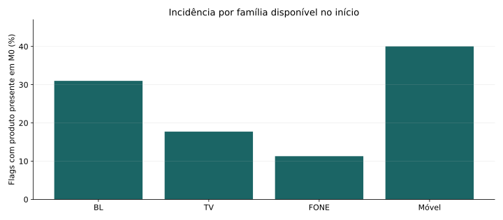

# Estudo executivo — Retenção e movimentação de produtos

*Apresentação de resultados observacionais · telecomunicações · junho–dezembro/2025 · uso restrito*

---

## 1. Pergunta central

**Quais características distinguem registros de clientes retidos com movimentação, e o que essas transições dizem sobre o valor observado?**

Esta apresentação comunica resultados da amostra; não contém registros individuais, demonstração de receita faturada ou afirmações causais.

---

## 2. Três resultados que não são intercambiáveis

**Retenção:** status **`RETIDO`** no funil. **Movimentação:** alguma **`FLAG_MOV_*`**. **Valor:** Σ M30 − Σ M0 dos campos monetários. Permanência futura, aceite de oferta e receita realizada não foram demonstrados.

---

## 3. A população investigada

- 303.652 registros dentro de junho–dezembro, após exclusão de dois fora da janela;
- 249.309 `RETIDO`, 48.091 `NAO RETIDO`, 6.252 `LEAD EM ABERTO`;
- 14.069 IDs de cliente repetidos; episódios únicos ainda não identificados.

**Denominador:** registro de entrada no funil. Não extrapolar ao universo da empresa.

---

## 4. A principal medida de movimentação

**86.540 registros** são retidos com ao menos uma movimentação, equivalentes a **34,7% dos retidos**. Não se confunde com aceite de oferta nem com permanência do cliente.

---

## 5. Viés de oportunidade das carteiras multiproduto

Com três famílias, 40,3% dos retidos têm alguma movimentação; por oportunidade presente em M0, o índice de flags é 21,4%. A diferença mostra por que normalizar importa.

---

## 6. Heterogeneidade entre produtos

BL 31,0%; TV 17,7%; Fone 11,3%; móvel 40,0% quando presentes em M0, entre retidos. Taxas de flags por família, não de oferta aceita.

---

## 7. Evolução mensal do status

Participação do status `RETIDO` entre encerrados: 85,1% em junho e 82,3% em dezembro. Não concluir redução da eficiência sem controlar amostragem e fechamento.

---

## 8. Origem: maturidade assimétrica

`LEGADO` apresenta 6.162 leads em aberto entre 68.380 registros (9,0%); `SOLAR`, 90 entre 235.272 (0,04%). Comparações diretas de retenção entre origens são sensíveis ao fechamento.

---

## 9. A implicação econômica não é trivial

No grupo retido com movimentação: mediana M30 − M0 = −25,46; 78,7% apresentam diferença negativa. Os campos financeiros ainda não têm periodicidade e composição validadas.

---

## 10. O que o experimento de predição mostrou

Na base de teste cronológica de nov–dez/2025 (84.067 registros), árvore curta: AUC 0,662; AP 0,405; Brier 0,1849 versus 0,1988 da baseline; lift top decil 1,84×.

**Alvo:** `RETIDO` + movimento entre encerrados. Não é efeito causal nem o perfil condicionado aos retidos.

---

## 11. Limites do benchmark de modelos

A diferença de Brier na validação entre árvore e regressão logística é apenas 0,000082. A regressão não foi comparada no holdout. Calibração e robustez permanecem pendentes; não escolher uma política comercial por AUC.

---

## 12. Quatro prioridades mensuráveis

1. Testar políticas estratificadas por mix e exposição real a produtos.
2. Investigar quedas de valor apesar de retenção e conciliar natureza dos valores.
3. Reconciliar SLA/idade dos leads abertos, especialmente em LEGADO.
4. Validar score prospectivamente e testar oferta com grupo controle.

---

## 13. Evidências que não permitem extrapolação

- Sem chave oficial de episódio.
- Sem receita líquida, margem, custos de intervenção ou aceite de oferta.
- Sem data de resolução e duração observável.
- Sem desenho causal.

**Conclusão científica:** perfis descritivos e sinais de valor foram caracterizados; impactos econômicos incrementais requerem novos dados ou experimentos.

---

## 14. Decisão solicitada ao negócio

Validar a chave do atendimento, a regra de encerramento, a natureza financeira dos valores e a identificação das ofertas. Essas definições habilitam a segunda etapa: teste prospectivo e otimização econômica de retenção.

*Fonte: execução local da planilha 2025; agregados e metodologia no relatório do estudo.*